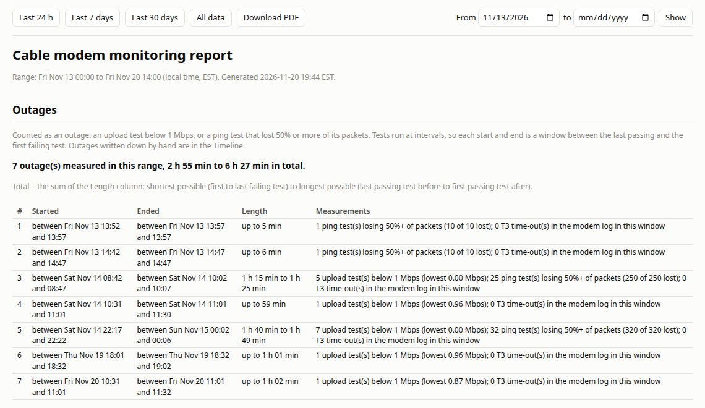
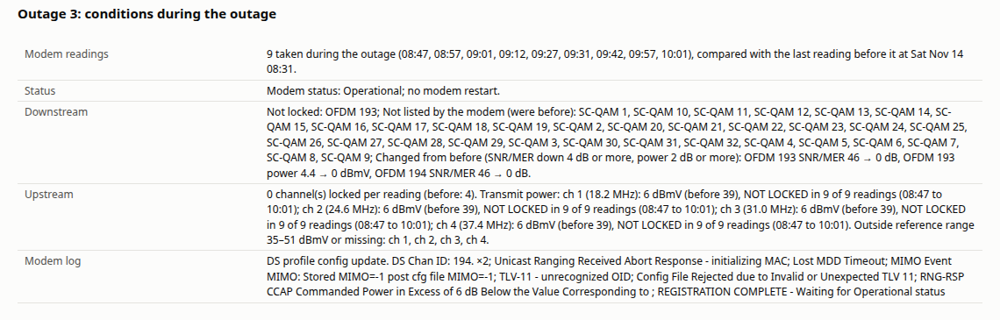
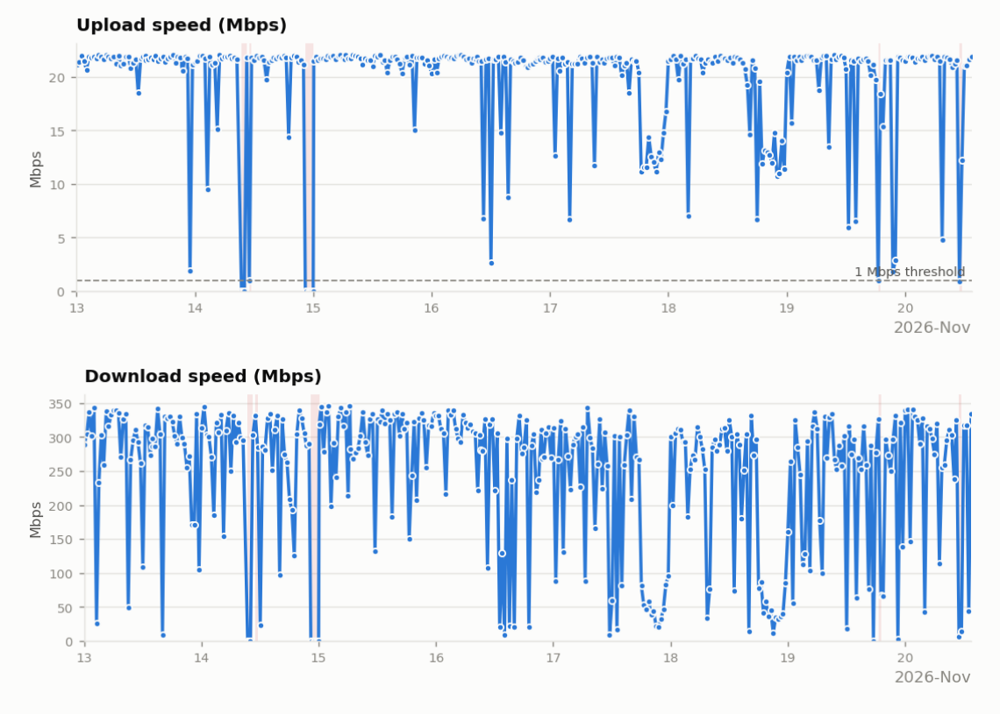
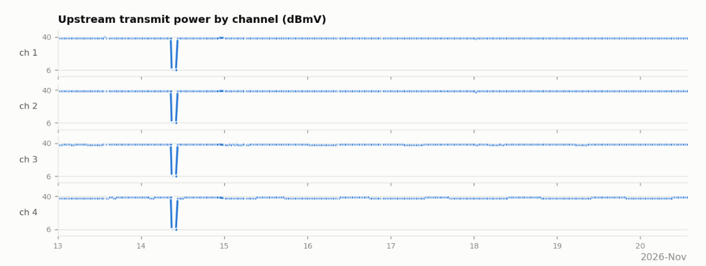

<p align="left">
  <picture>
    <source media="(prefers-color-scheme: dark)" srcset="assets/brand/zs-logo-horizontal-dark-bg.svg">
    
  </picture>
</p>

# modem_check

Monitors an **ARRIS SURFboard SB8200** cable modem and your internet connection, and builds a
factual report you can hand to your ISP: outages with start/end windows, modem conditions during
each outage, channel levels and errors, speed and ping results, and the modem's event log.

It was written to document an intermittent upload outage on a DOCSIS 3.1 connection (T3 time-outs,
upstream channels losing lock), where the ISP needed evidence collected while the problem was happening.

- Logs in to the modem's web UI (the newer CBN "HS:" firmware with AES-encrypted login) and records
  status, uptime, the modem clock, every downstream/upstream channel (lock, power, SNR, codeword
  counters) and the event log.
- Runs a ping test every 5 minutes and a full run (modem + ping + speed test) every 30 minutes. A
  failed ping test starts a full run right away, so outages get modem readings taken during them.
- Stores everything in SQLite.
- Serves a dashboard on your LAN and produces HTML/PDF reports with an outage summary, per-outage
  snapshots, charts, and daily speed/ping summaries. Wording sticks to what was measured.

Tested with an SB8200 (hardware 3.0, firmware AC01.01.008_122722_8200.03.07.733) on Ubuntu 22.04
(Orange Pi 5) and Ubuntu 26.04, Python 3.10+. Other firmware versions may use different pages.

## Screenshots

Seven days of real data from the dashboard (identifiers replaced with documentation values).

**Outage summary.** Each outage has a start and end window, a length range and what was measured.



**Conditions during an outage.** Modem readings taken during the outage, compared with the last reading before it.



**Speed tests.** Shaded spans are outages. Values show on hover or tap in the dashboard.



**Upstream transmit power per channel.** The drop on Nov 14 is the modem losing its upstream channels.



## Setup

```bash
git clone https://github.com/zspalding12083/modem_check.git ~/modem_check
cd ~/modem_check
pip3 install --user requests cryptography matplotlib
cp config.example.ini config.ini && chmod 600 config.ini   # then edit: modem password, interface
python3 modem_check.py check                                 # test the login; prints the modem's certificate fingerprint
python3 -m unittest discover -s tests                        # parser tests against saved sample pages
```

`curl` and `ping` must be installed. PDFs need Chrome/Chromium; if a snap-packaged Chromium does not
start (some ARM boards), `pip3 install --user playwright && python3 -m playwright install chromium`
provides a headless build that is found automatically.

If `check` cannot reach the modem, see [Reaching the modem through your router](#reaching-the-modem-through-your-router).

Run it on schedule with systemd user units (they expect the project at `~/modem_check`):

```bash
mkdir -p ~/.config/systemd/user
systemctl --user link ~/modem_check/systemd/*.service ~/modem_check/systemd/*.timer
systemctl --user daemon-reload
systemctl --user enable --now modem-check.timer modem-ping.timer modem-dashboard.service
loginctl enable-linger "$USER"     # keep running when you are logged out
```

## Commands

```bash
python3 modem_check.py check                 # read-only status, no database writes
python3 modem_check.py poll                  # full run: modem + ping + speed test
python3 modem_check.py poll --no-tests       # modem only
python3 modem_check.py ping                  # ping test; starts a full run if the line looks unhealthy
python3 modem_check.py note "Tech visit: replaced drop" --at "2026-10-06 10:00"
python3 modem_check.py report --pdf          # everything so far -> reports/*.html + .pdf
python3 modem_check.py report --since 2026-10-09 --until 2026-10-10 --pdf
python3 dashboard.py --port 8520                  # dashboard on 127.0.0.1 (also installed as a service)
```

## Configuration (`config.ini`)

| Section / key | Default | Meaning |
|---|---|---|
| `[modem] host`, `username`, `password` | 192.168.100.1, admin | Modem web UI login (`MODEM_PASSWORD` env var overrides) |
| `[modem] cert_sha256` | (none) | Pin the modem's self-signed certificate (fingerprint from `check`); recommended, see Security |
| `[modem] interface` | (none) | Bind every test to this NIC (e.g. `eth0`), so tests use the cable connection even when a VPN is up |
| `[tests] ping_targets`, `ping_count` | google.com, 10 | Ping test |
| `[tests] download_bytes`, `upload_bytes`, `speedtest_timeout` | 100 MB, 25 MB, 30 s | Speed test size and time cap |
| `[tests] upload_outage_mbps`, `ping_outage_loss_pct` | 1, 50 | What counts as an outage in the report |
| `[tests] ping_trigger_ms`, `trigger_cooldown_min` | 100, 10 | When a ping test starts an extra full run |
| `[ranges] …` | DS power −15…+15 dBmV, SNR ≥ 33 dB, US power 35…51 dBmV | Reference ranges flagged in outage snapshots |

## How the measurements work

All tests run one after another (a shared lock keeps a ping from measuring a speed test in progress).

| Test | What it does |
|---|---|
| Ping | `ping -c 10 -i 0.5 -W 2` to each target; records loss and min/avg/max RTT |
| Download | `curl` GETs of 25 MB blocks from `speed.cloudflare.com/__down` until 100 MB or 30 s; Mbps = bytes × 8 ÷ time |
| Upload | One `curl` POST of 25 MB of random data to `speed.cloudflare.com/__up`, capped at 30 s; failures record curl's error (timed out, connection reset, …) |
| Modem | `xml/getter.xml` functions 1, 6, 9, 10, 11, 13, 19 after an encrypted login via `xml/setter.xml` (fun 15); logs out after each run |

Notes:
- Single-connection tests can read lower than multi-connection tests (e.g. Ookla) on fast lines.
- A full run uses up to 100 MB down + 25 MB up (about 6 GB / 1.2 GB per day at 48 runs).
- Each modem login adds a line to the modem's small event log; that's why the 5-minute check is a
  ping test only. The report leaves the tool's own login entries out.
- Codeword counters are cumulative and reset on modem restart or re-initialization; the report works
  with increases between readings and skips intervals where a channel had no signal (the modem keeps
  counting failed decodes on a channel it can't receive).
- The modem's clock may differ from local time; each poll records the difference and the report shows
  event times both as logged and converted.

## Reaching the modem through your router

The SB8200 answers at `192.168.100.1` even though your router's WAN port has a public address from the
ISP. Your LAN does not include that address, so a request to it goes to your router, out the WAN port, and
the modem picks it up. Test first from the machine that will run the tool:

```bash
ping -c 3 192.168.100.1
curl -sk -o /dev/null -w '%{http_code}\n' https://192.168.100.1/    # 200 means the web UI is reachable
```

Many consumer routers pass this through with no changes. If yours does not, the router needs an address
on the modem's `192.168.100.0/24` network on its WAN side, and needs to NAT traffic for that network
to that address.

### pfSense / Netgate (the setup this project runs behind)

1. **Firewall → Virtual IPs → Add**
   - Type **IP Alias**, Interface **WAN**.
   - Address **192.168.100.2 / 24**. Pick an address that is not `.1`.
   - Description "Modem access", then **Save** and **Apply Changes**.
2. **Firewall → NAT → Outbound**
   - Switch mode from Automatic to **Hybrid** and **Save**.
   - **Add** a mapping: Interface **WAN**, Address Family **IPv4**, Protocol **any**.
   - Source **LAN subnets**, or just the monitoring machine's address as `/32`.
   - Destination **Network 192.168.100.0 / 24**.
   - Translation Address **192.168.100.2 (Modem access)**.
   - **Save** and **Apply Changes**.
3. **Firewall rules.** If the monitoring machine is on a VLAN whose rules block private networks
   (RFC 1918), add a pass rule to `192.168.100.1` above the block rule.

Once this is set up, the modem's event log shows the tool's logins as `client ip=[192.168.100.2]`.

### OPNsense

The same two steps:
1. **Interfaces → Virtual IPs → Settings**: add an IP Alias on WAN, `192.168.100.2/24`.
2. **Firewall → NAT → Outbound**: choose Hybrid mode and add a rule. Interface WAN, destination
   `192.168.100.0/24`, translation the new virtual IP.

### Other home routers

- **Netgear, TP-Link, ASUS, Linksys, eero, Google/Nest Wifi, UniFi gateways:** in router mode these usually
  reach the modem without any changes. Run the test above before changing anything.
- **A mesh system or second router behind the main one (double NAT):** this also works, because each
  router forwards the traffic upstream. Run the tool on any machine that can reach the internet.
- **Routers that block private destinations on the WAN** (some security or "anti-spoofing" options): look
  for a setting such as "Block private networks", "RFC 1918 filter" or "Bogon filter" on the WAN and
  turn it off. pfSense and OPNsense apply these filters to incoming traffic only, so they do not
  get in the way here.
- **Routers with a static route or WAN alias option:** add the alias the same way as on pfSense, if the
  router offers one.
- **ASUS with Asuswrt-Merlin:** a `wan-event` script can add the alias, for example
  `ip addr add 192.168.100.2/24 dev eth0`. Use your WAN interface name.
- **VPN on the monitoring machine:** a full-tunnel VPN sends `192.168.100.1` into the tunnel. Set
  `[modem] interface = eth0` (your wired NIC) so the tool goes around it.
- **Guest, IoT or isolated networks:** these often block everything except the internet. Run the tool
  from your main LAN, or allow `192.168.100.1` from that network.

Use the IP address, not a hostname. Once it works, set `cert_sha256` (see Security), so the password
is only ever sent to your modem.

## Dashboard

`dashboard.py` serves the report at `http://127.0.0.1:8520/`, rebuilt from the database on every page load,
with range buttons (24 h / 7 days / 30 days / all / custom) and a "Download PDF" link. Chart values show on
hover or tap.

It has **no login**, and the report includes your modem's MAC, serial number and connection history, so
the service listens on localhost only. To view it from other devices on your LAN (e.g. a phone), opt in:

```bash
systemctl --user edit modem-dashboard.service
# add:
#   [Service]
#   ExecStart=
#   ExecStart=/usr/bin/python3 %h/modem_check/dashboard.py --port 8520 --bind 0.0.0.0
systemctl --user restart modem-dashboard.service
```

Only do this on a network you trust, and never forward the port to the internet.

## Security

- **Modem password.** The SB8200 serves HTTPS with a self-signed certificate, and its login "encryption"
  is keyed from a token the modem sends, so it only protects against casual viewing. Anything that can
  impersonate the modem on your network could capture the password. Run the tool on a trusted wired LAN,
  and set `cert_sha256` (printed by `python3 modem_check.py check`): connections to anything presenting a
  different certificate are then refused before the password is sent. If the modem's certificate changes
  (e.g. after a firmware update), `check` reports the mismatch and shows the new fingerprint.
- **Secrets.** `config.ini` is git-ignored; keep it `chmod 600`. The password can come from the
  `MODEM_PASSWORD` environment variable instead.
- **Reports and database** (`reports/`, `data/`) contain your modem's identifiers and connection
  history; they are git-ignored. Review a report before sharing it.

## License

MIT, see [LICENSE](LICENSE). The ZS Tech mark files in `assets/brand/` are not covered by the MIT
License: they are all rights reserved and may be used only to identify ZS Tech (Zachary Spalding Technology Services) and its projects.

---

 A **ZS Tech** project · Zachary Spalding Technology Services · [zspalding12083](https://github.com/zspalding12083). Systems · Networks · Cloud · Open source.
